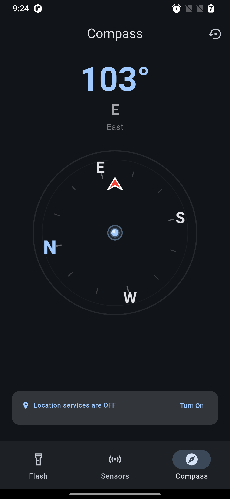
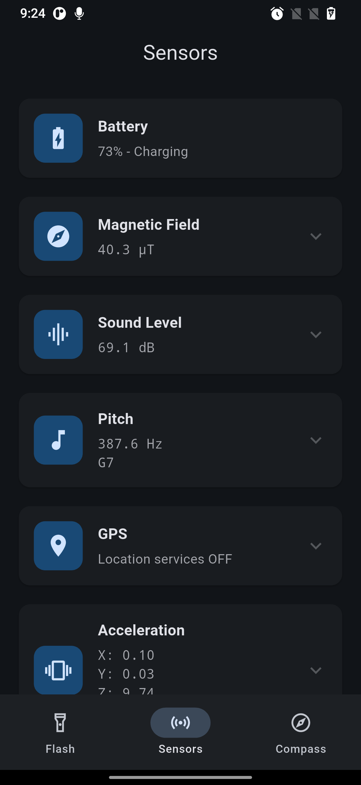
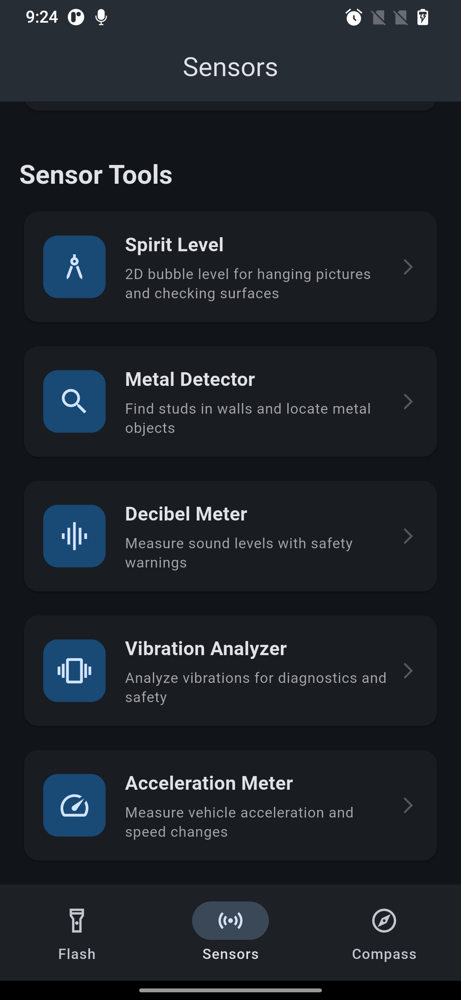
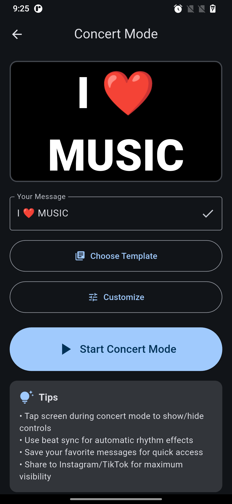
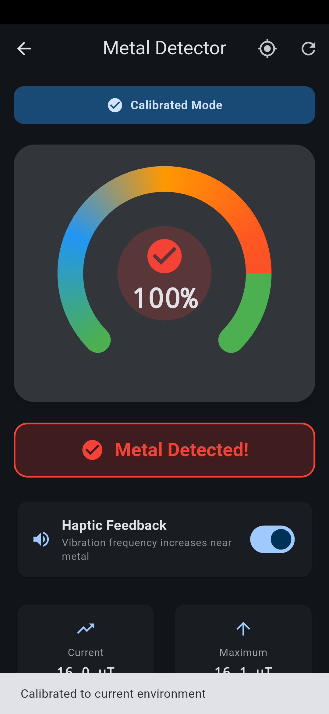
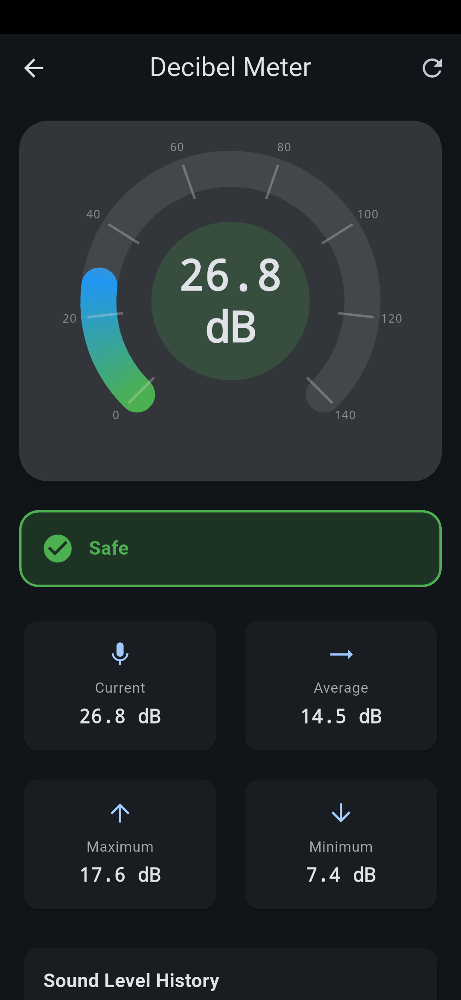

<div align="center">

# AniniTools

### Your phone's hidden superpowers, in one app.

**Flashlight · Concert Flash · Strobe · Sound Meter · Spirit Level · Compass · Magnetic Field — and a full lab of real-time sensors.**

AniniTools brings your phone's lights and available sensors into one toolkit — for a concert, a walk, a surface check or a sensor experiment.

<br/>

<a href="https://apps.apple.com/us/app/sound-meter-level-tools/id6755042830">
  
</a>
&nbsp;&nbsp;
<a href="https://play.google.com/store/apps/details?id=anini.aninitools">
  
</a>

<br/><br/>


</div>

---

## Why people keep AniniTools on their home screen

🔦 **The brightest, fastest flashlight** — one tap to torch. Plus a full-screen color light when you need a glow, not a beam.

🎶 **Own the concert** — scrolling custom text in any color, beat-synced strobe, and flash patterns that turn your phone into the loudest fan in the crowd.

🔊 **Microphone Level** — compare the recorded signal and detect musical pitch. The microphone is not calibrated to measure physical sound pressure or hearing safety.

📐 **Spirit Level & Compass** — hang the shelf straight, find magnetic north. The tools you wish you had exactly when you need them.

🧲 **Magnetic Field** — view changes near magnetic objects. Detection depends on the object and your device; it cannot find every metal or wall stud.

📊 **A real sensor lab** — live, graphed readouts for accelerometer, gyroscope, magnetometer, GPS, barometer, proximity, light, and battery. Great for makers, students, and the endlessly curious.

⛰️ **Altitude & Vibration estimate** — view pressure/GPS altitude and a motion-based vibration estimate. These are not equipment diagnostics.

> **One app. A dozen tools. Zero clutter.**

---

## See it in action

<div align="center">

| | | |
|:-:|:-:|:-:|
|  |  |  |
|  |  |  |

</div>

---

## Everything inside

| Lights & Show | Measure & Build | Sensor Lab |
|---|---|---|
| Instant flashlight | Microphone signal level | Accelerometer |
| Full-screen color light | Spirit level (2D bubble) | Gyroscope |
| Concert scrolling text | Compass + coordinates | Magnetometer |
| Beat-synced strobe | Magnetic field | GPS / location |
| Custom flash patterns | Altitude calculator | Barometer (pressure) |
| | Vibration estimate | Proximity · Light · Battery |

---

## Built for trust

- **Free to download.**
- **No account, no sign-up.** Open the app and go.
- **Optional reports start off.** Sensor readings and messages are processed locally. Privacy lets you choose whether Google receives use and crash reports. Read the [English and Bahasa Malaysia policy](docs/privacy.html).

---

<div align="center">

### Ready to unlock your phone?

<a href="https://apps.apple.com/us/app/sound-meter-level-tools/id6755042830">
  
</a>
&nbsp;&nbsp;
<a href="https://play.google.com/store/apps/details?id=anini.aninitools">
  
</a>

</div>

---

<details>
<summary><h2>For developers</h2></summary>

AniniTools is a cross-platform **Flutter** app (Android + iOS) using an MVVM architecture with `provider` for state management. Sensor access is built on `sensors_plus`, `geolocator`, `battery_plus`, `torch_light`, and `record` + `fftea` for audio/FFT analysis, with `fl_chart` for live graphs.

### Run locally

```bash
flutter pub get
flutter run            # Android or iOS device/simulator
```

Before a release, run `./scripts/preflight.sh secrets placeholders project review`. It checks for exposed keys, unfinished release settings, and a current passing review.

### Build releases

```bash
flutter build apk --release       # Android
flutter build appbundle --release # Android (Play Store)
flutter build ios --release       # iOS
```

### Project layout

```
lib/
├── models/        # data models + SharedPreferences wrapper
├── viewmodels/    # ChangeNotifier business logic
├── views/         # UI screens (flashlight, sensors, tools, compass)
├── services/      # sensor + audio abstractions
└── widgets/       # reusable components (graphs, renderers, cards)
```

**Verified toolchain:** Flutter 3.47.4 / Dart 3.13.3. Android minSdk 24 / target 36 · iOS 15+.

> Note: Firebase config (`firebase_options.dart`, `google-services.json`, `GoogleService-Info.plist`) and signing keys are intentionally not committed. Provide your own via `flutterfire configure` to build the Firebase-backed features.

</details>

## License

MIT — see [LICENSE](LICENSE).
